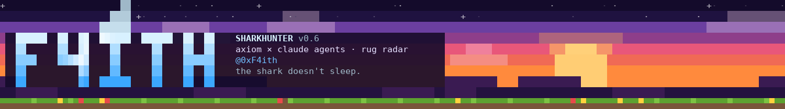
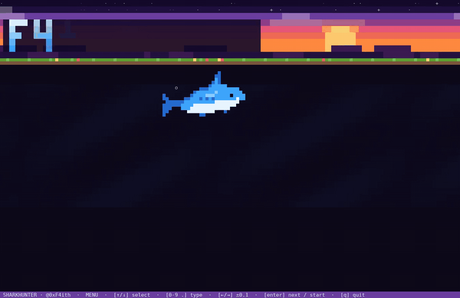
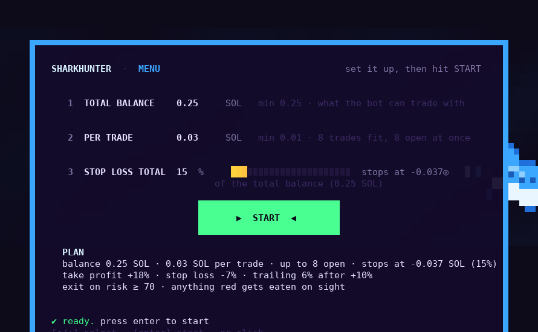
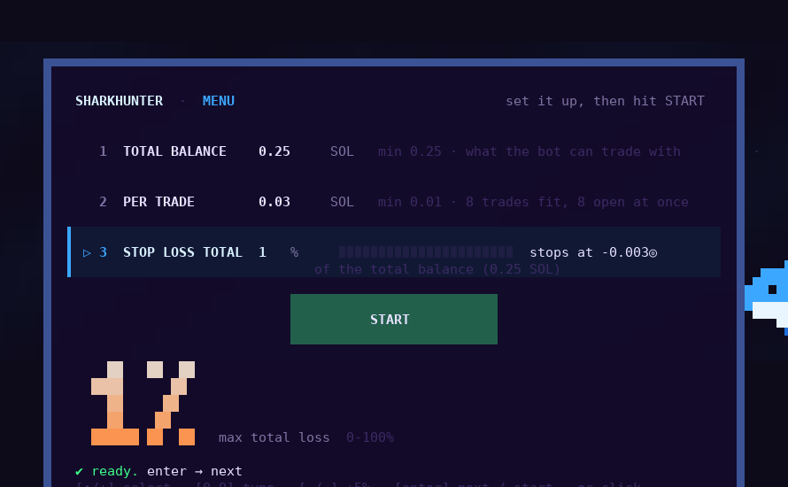
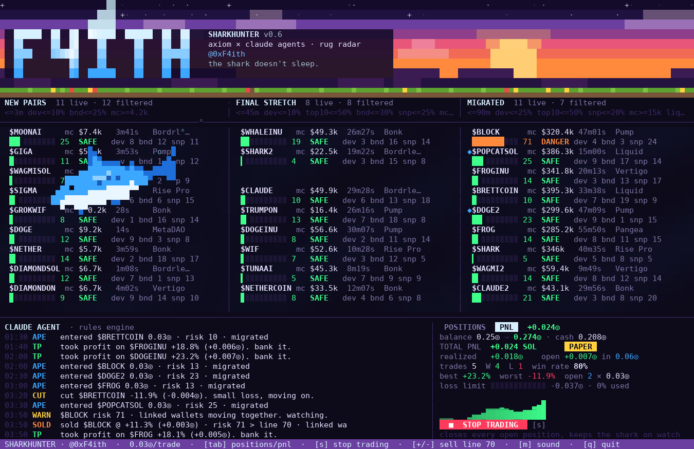
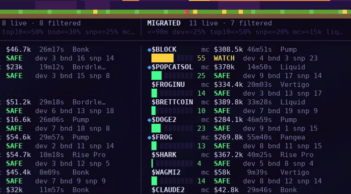
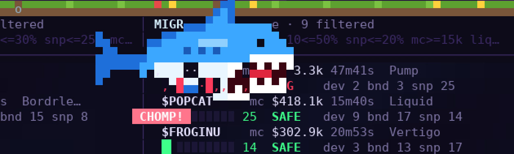
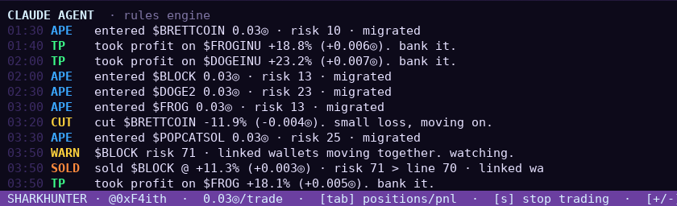
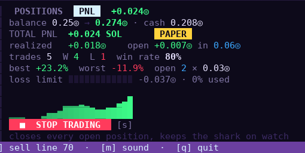

<p align="center">
  
</p>

<h1 align="center">SharkHunter 🦈</h1>

<p align="center">
  <b>Terminal rug radar and trading bot for Solana memecoins.</b><br>
  Your Axiom filter presets plus Claude agents, plus a pixel shark that eats every coin about to rug.<br>
  by <a href="https://x.com/0xF4ith">@0xF4ith</a>
</p>

<p align="center">
  
</p>

---

## ⬇️ Download and open

Grab your file from **[Releases](../../releases/latest)**. No install, no Node.js needed.

| System | Download | How to open |
|---|---|---|
| 🪟 **Windows** | `SharkHunter-windows.zip` | Unzip, then double-click **SharkHunter.exe**. If you see *"Windows protected your PC"*, click **More info → Run anyway**. |
| 🍎 **Mac (M1/M2/M3/M4)** | `SharkHunter-mac-apple-silicon.zip` | Unzip. The first time, **right-click SharkHunter → Open → Open**. After that, double-click works. |
| 🍎 **Mac (Intel)** | `SharkHunter-mac-intel.zip` | Same as above. |
| 🐧 **Linux** | `SharkHunter-linux.tar.gz` | `tar xzf SharkHunter-linux.tar.gz && ./SharkHunter-linux/sharkhunter` |

> **Tip:** the window should be at least **150 × 46**, so maximize it. Colors look best in **Windows Terminal** and in **iTerm2** on Mac.

---

## 1 · Set it up

When the app opens, you get the start menu:

<p align="center"></p>

| # | Setting | What it means |
|---|---|---|
| 1 | **Total balance** | How much SOL the bot can trade with. **Minimum 0.25.** |
| 2 | **Per trade** | The size of each entry. **Minimum 0.01**, and never more than the balance. A 0.25 balance at 0.03 per trade fits 8 trades. |
| 3 | **Stop loss total** | **0–100% of the balance.** If total PnL drops that far, the bot sells everything and stops itself. The menu shows the exact SOL. |
| 4 | **START** | Checks your values (bad ones shake red), then starts trading. |

<p align="center"></p>

Controls: **↑/↓** move · type numbers · **←/→** adjust · **Enter** next / start · or click with the mouse.

---

## 2 · The radar

<p align="center"></p>

- **Three lanes, same as Axiom:** **NEW PAIRS · FINAL STRETCH · MIGRATED**. Each lane uses your own Axiom filter preset.
- Every coin gets a **risk score from 0 to 100** that updates live, built from dev holding, top-10 concentration, bundles, snipers, fresh wallets, mint and freeze authority, linked wallets moving together, sell pressure, dev selling and LP pulls.
- Bands: 🟢 **SAFE** (<35) · 🟡 **WATCH** (35+) · 🟠 **DANGER** (60+) · 🔴 **RUG** (80+)
- Filters decide which coins **get on** the radar. Once a coin is on it, the shark keeps watching it.

---

## 3 · The shark

<p align="center"></p>

- It swims the lanes in any direction and never leaves the screen.
- When a coin nearby goes **DANGER**, it races over and **circles it**.
- **The moment a coin turns red, the shark eats it:** jaws open, teeth out, it chews through the card from one end to the other. Crumbs fly, a little blood, a crunch sound. That coin never comes back on the radar.

<p align="center"></p>

---

## 4 · Trading and PnL

<table>
<tr>
<td width="62%"></td>
<td></td>
</tr>
</table>

**The strategy** (small losses out fast, profits on small risk):
- **Entry:** clean coins only (risk under 35) in Final Stretch and Migrated, and only when enough cash is free in the balance.
- **Take profit:** +18%. **Stop loss:** −7%. **Trailing stop:** 6% below the peak once a trade is up +10%.
- **Risk exit:** sells when risk crosses the sell line (70 by default, change it with `+`/`-`).
- **Total stop loss:** stops the whole bot at your % of the balance.

**The PNL tab** (`Tab`, or click it) shows balance → equity, cash, realized and open PnL, trades, win rate, best and worst trade, how much of the loss limit is used, and an equity curve.

**■ STOP TRADING** (`s`, or click it) sells every open position and pauses entries. The shark keeps guarding. Press again to start.

### Keys

| Key | Action |
|---|---|
| `Tab` | switch POSITIONS / PNL |
| `s` | stop / start trading |
| `+` / `-` | move the sell line |
| `m` | sound on/off |
| `q` | quit |

---

## ⚠️ Trading mode: PAPER

Right now SharkHunter **paper trades**: real strategy logic, **no real orders, no wallet**. The PNL tab says **PAPER**. Axiom has no public trading API, so the app can't log into an Axiom account. Live trading will mean signing swaps from your own burner wallet, with hard spend limits, behind an explicit `--live` switch. **Never put a main wallet key into any bot.**

---

## Use your own Axiom filters

Export your presets from Axiom (New Pairs, Final Stretch, Migrated) and drop the `.json` files into the **`filters`** folder next to the app. They replace the built-in ones.

## Optional: real Claude verdicts

Set an Anthropic API key and the agent log gets live Claude one-liners (marked ◆):

```bash
# Mac / Linux
ANTHROPIC_API_KEY=sk-... ./SharkHunter
# Windows PowerShell
$env:ANTHROPIC_API_KEY="sk-..."; .\SharkHunter.exe
```

## Command-line options

```
--balance 0.25 --size 0.03 --max-loss 15   skip the menu
--sell-line 65                              exit earlier on risk
--mute                                      no sound
--filters <folder>                          use presets from another folder
```

---

## For developers

```bash
git clone https://github.com/0xF4ith/SharkHunter.git
cd SharkHunter
npm start                  # run from source (Node 18+, no dependencies)
npm i && npm run build     # build standalone apps into dist/
bash tools/package.sh      # zip them into release/
bash tools/record.sh 13 60 demo.mp4   # record a demo video with sound (needs ffmpeg + Pillow)
```

**Releasing:** bump `version` in package.json and push to `main`. GitHub Actions builds and signs all four apps and publishes them as a Release (tags `v*` and Actions → release → Run workflow work too):

```bash
# bump "version" in package.json, then:
git push origin main
```

### Project layout

```
src/
  index.js     entry: menu, keys, mouse, render loop, recording
  app.js       the screen: header, lanes, cards, menu, tabs, PnL
  shark.js     the shark: movement, hunting, eating
  agent.js     trading brain: entries, TP/SL/trailing, ledger, stop
  risk.js      rug-risk score 0-100
  filters.js   loads and applies Axiom presets
  feed.js      coin feed (swap in a real Solana adapter here)
  canvas.js    cell renderer, truecolor + 256-color fallback
  sound.js     bite sound playback
filters/       Axiom presets (newPairs / finalStretch / migrated)
assets/        bite.wav
tools/         build, package, record, screenshot and sound scripts
.github/       release workflow
```

**Going live:** `src/feed.js` is the data source. To use real coins, write an adapter with the same interface (`tokens[]` plus `tick()` returning events) on top of a Solana RPC or websocket (Helius, Triton), pump.fun / PumpSwap program logs, or DexScreener.

---

<p align="center"><i>the shark doesn't sleep.</i> 🦈</p>
